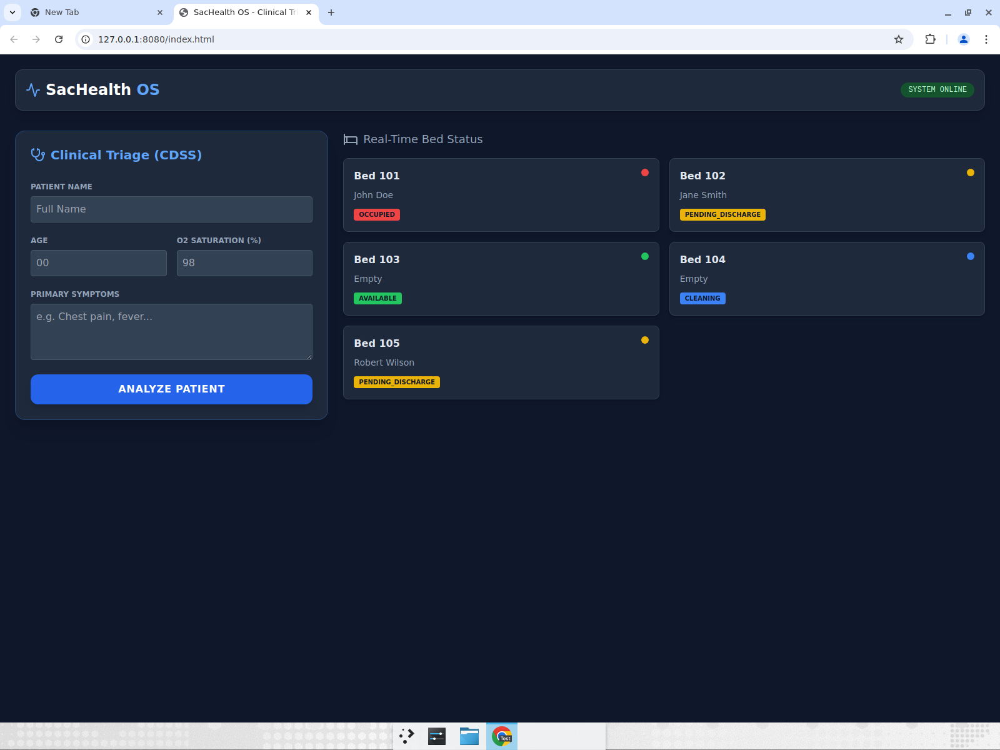
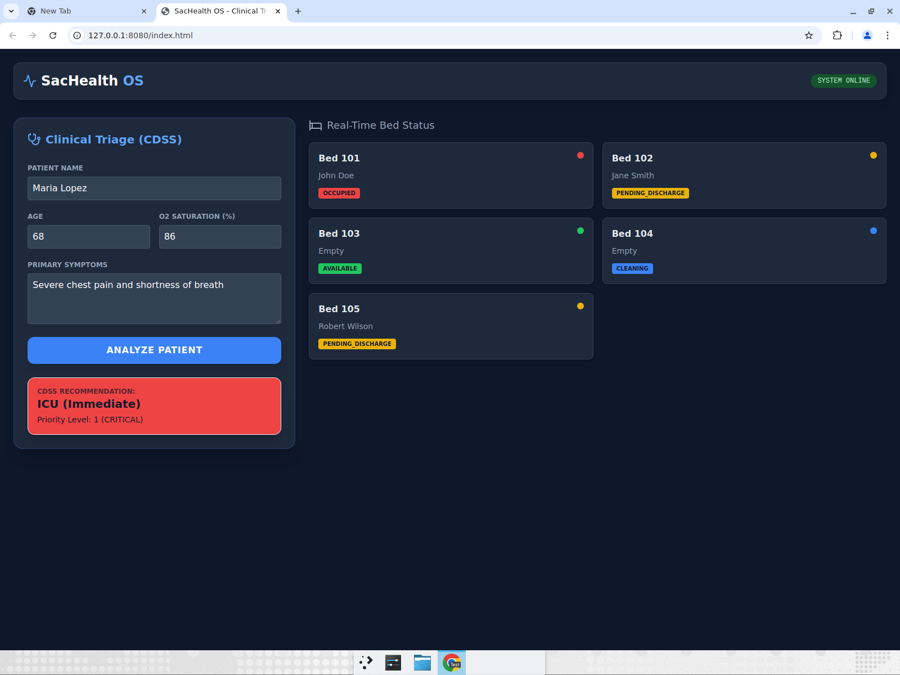

# 🏥 SacHealth OS — Clinical Triage & Bed Management System

> A HealthTech prototype that streamlines critical-patient flow and reduces hospital bottlenecks, inspired by the saturation challenges faced by hospitals in Sacramento, CA.

🔗 **[Live Demo](https://coderblockch.github.io/sachealth-os/)** &nbsp;·&nbsp; *(enable GitHub Pages to activate)*

---

## 📸 Screenshots

| Dashboard | Triage Result |
|-----------|---------------|
|  |  |

---

## 🚀 Overview

SacHealth OS helps emergency departments prioritize high-risk patients and manage limited resources in real time. It combines a **rule-based Clinical Decision Support System (CDSS)** for triage with a live **bed-management dashboard**, plus an insurance authorization workflow to reduce administrative delays.

The system is designed around **graceful degradation**: if the backend is unavailable, the interface clearly signals the offline state instead of crashing, so clinicians are never left staring at a broken screen.

---

## 🌟 Key Features

- **Clinical Decision Support System (CDSS):** A rule-based triage engine that assigns patient priority levels using established clinical thresholds (e.g. oxygen saturation, chest-pain indicators) to recommend the appropriate care level — from ICU to standard observation.
- **Bed Management Dashboard:** Real-time visualization of hospital capacity and occupancy.
- **Insurance Authorization Workflow:** Streamlined tracking of approval status to cut administrative bottlenecks.
- **Dark-Mode Clinical UI:** A focused, low-glare interface suited to high-stress hospital environments.

---

## 🛠️ Tech Stack

| Layer | Technologies |
|-------|--------------|
| **Frontend** | HTML5, CSS3 (Dark-Mode UI), JavaScript (ES6+) |
| **Backend** | Python, FastAPI, Pydantic |
| **Architecture** | Client-side logic with graceful degradation; REST API |

---

## 🧠 How the Triage Engine Works

The CDSS evaluates patient vitals and symptoms against clinical rules to assign one of several priority levels. For example:

| Condition | Priority | Recommendation |
|-----------|----------|----------------|
| O₂ saturation < 90% or chest pain | **1 — Critical** | ICU (Immediate) |
| Moderate symptoms | **2 — Urgent** | Monitored bed |
| Stable vitals | **3 — Standard** | General observation |

> This is a **rule-based** system grounded in clinical logic — a recognized and widely used category of decision support in real healthcare settings. It does not use machine learning; priorities are deterministic and fully auditable, which is often *preferred* in clinical contexts for transparency and safety.

---

## ⚙️ Running Locally

Start the **backend first** (so the dashboard can load live bed data), then serve the frontend.

### 1. Backend (FastAPI + SQLModel)

```bash
git clone https://github.com/coderblockch/sachealth-os.git
cd sachealth-os/backend
python3 -m venv venv
source venv/bin/activate          # On Windows: venv\Scripts\activate
pip install -r requirements.txt
uvicorn main:app --reload
# API available at http://127.0.0.1:8000  (docs at /docs)
```

On first run the app creates a local SQLite database (`sachealth.db`) and seeds it
with sample beds. No external database or configuration is required.

### 2. Frontend

From the repository root, in a **second terminal**:

```bash
python3 -m http.server 8080
# Visit http://localhost:8080
```

The frontend calls the backend at `http://127.0.0.1:8000` (see `API_URL` in
`index.html`). If the backend is not running, the dashboard degrades gracefully:
it shows a clear `BACKEND OFFLINE` status instead of crashing.

> **No secrets or API keys are required to run this project.** If you later add a
> hosted backend, point `API_URL` in `index.html` to it — do not hardcode any
> credentials in the repo.

---

## 📁 Project Structure

```
sachealth-os/
├── index.html            # Frontend dashboard (triage + bed management)
├── backend/
│   ├── main.py           # FastAPI app: CDSS triage + bed endpoints
│   ├── database.py       # SQLModel engine & session setup (SQLite)
│   ├── models.py         # Bed data model
│   └── requirements.txt  # Backend dependencies
├── docs/                 # Screenshots used in this README
├── .gitignore
├── LICENSE
└── README.md
```

---

## 🗺️ Roadmap

- [ ] Connect frontend to the FastAPI backend for live data.
- [ ] Persist patient and bed data in a database (PostgreSQL).
- [ ] Add authentication for clinical staff roles.
- [ ] Deploy the full stack (frontend + API) to a cloud host.

---

## 👤 Author

**David Jimenez** — Full Stack Developer in training · Sacramento, CA

- GitHub: [@coderblockch](https://github.com/coderblockch)

---

## 📄 License

Distributed under the MIT License. See [`LICENSE`](LICENSE) for details.

---

> ⚠️ **Disclaimer:** SacHealth OS is an educational prototype and is **not** intended for real clinical use or actual patient care decisions.
