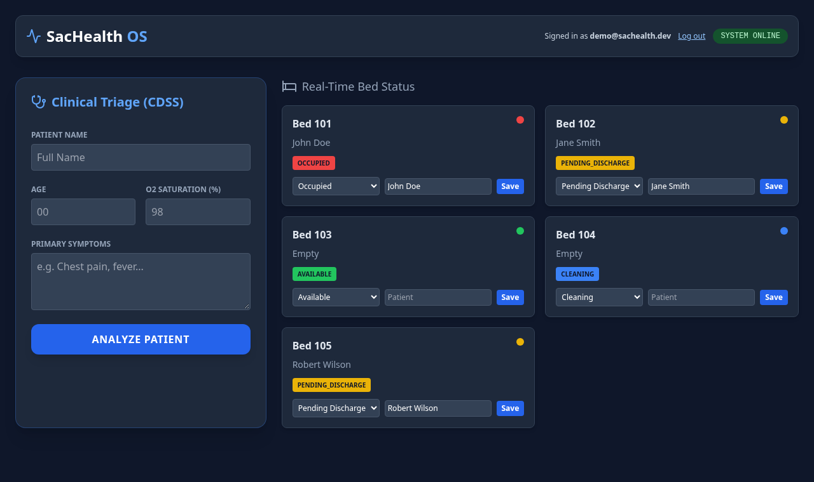

# 🏥 SacHealth OS — Clinical Triage & Bed Management System

> A HealthTech prototype that streamlines critical-patient flow and reduces hospital bottlenecks, inspired by the saturation challenges faced by hospitals in Sacramento, CA.

🔗 **Live demo:** [sachealth-os.onrender.com](https://sachealth-os.onrender.com) · **API docs (Swagger):** [/docs](https://sachealth-os.onrender.com/docs)

**Demo login** (public demo account, fake data only): `demo@sachealth.dev` / `sachealth-demo`

> Hosted on Render's free tier: the first request after ~15 minutes of inactivity can take up to a minute while the instance wakes up. Demo data is stored in SQLite on an ephemeral disk and is reset to the seed data whenever the service restarts or redeploys.


| Signed in as staff: beds can be updated |
|---|
|  |

---

## 🚀 Overview

SacHealth OS helps emergency departments prioritize high-risk patients and see bed availability at a glance. It combines a **rule-based Clinical Decision Support System (CDSS)** for triage with a **bed-management dashboard** backed by a FastAPI REST API and a SQLite database.

Clinical staff sign in with email and password (bcrypt-hashed, JWT bearer tokens) to update bed status and assigned patients; reading beds and running a triage analysis are open to everyone in the demo.

The frontend handles failures gracefully: if the API is unreachable, it shows a clear **BACKEND OFFLINE** status and error messages instead of breaking.

---

## 🌟 Key Features

- **Clinical Decision Support System (CDSS):** A rule-based triage engine that assigns patient priority levels using established clinical thresholds (e.g. oxygen saturation, chest-pain indicators) to recommend the appropriate care level — from ICU to standard observation.
- **Bed Management Dashboard:** Bed cards loaded from the API, color-coded by status (Available, Occupied, Pending Discharge, Cleaning) with the assigned patient.
- **Staff Authentication:** Login with bcrypt-hashed passwords and short-lived JWT bearer tokens; write endpoints (`PATCH /beds/{id}`) require a valid token.
- **REST API + Database:** FastAPI endpoints with Pydantic request validation and SQLModel persistence (SQLite by default, PostgreSQL via `DATABASE_URL`); the database is created and seeded with sample beds and the demo user on startup.
- **Connection Status & Error Handling:** A live SYSTEM ONLINE / BACKEND OFFLINE badge and friendly messages when the API is down.
- **Dark-Mode Clinical UI:** A focused, low-glare interface (Tailwind CSS + Lucide icons) suited to high-stress hospital environments.

---

## 🛠️ Tech Stack

| Layer | Technologies |
|-------|--------------|
| **Frontend** | HTML5, Tailwind CSS (CDN), Lucide icons, JavaScript (ES6+, Fetch API) |
| **Backend** | Python, FastAPI, Pydantic, Uvicorn, PyJWT, bcrypt |
| **Database** | SQLite via SQLModel (SQLAlchemy); PostgreSQL supported via `DATABASE_URL` |
| **Testing & CI** | pytest (43 tests), GitHub Actions, CodeQL |
| **Hosting** | Render (free web service, `render.yaml` Blueprint) |

---

## 🏗️ Architecture

```
Browser ──► FastAPI (Uvicorn) on Render ──► SQLModel ──► SQLite (default) / PostgreSQL
              │
              ├── GET  /                 → serves index.html (Tailwind + vanilla JS dashboard)
              ├── GET  /health           → liveness probe
              ├── POST /auth/login       → verifies bcrypt hash, returns JWT
              ├── GET  /auth/me          → current user (Bearer token)
              ├── GET  /beds             → list beds
              ├── PATCH /beds/{id}       → update bed status/patient (Bearer token required)
              └── POST /triage/analyze   → rule-based CDSS priority
```

A single web service serves both the UI and the API, so the frontend calls the API on the same origin (no CORS needed in production). Interactive API documentation is generated by FastAPI at [`/docs`](https://sachealth-os.onrender.com/docs).

| Endpoint | Auth | Description |
|----------|------|-------------|
| `GET /health` | — | Liveness check |
| `POST /auth/login` | — | `{email, password}` → `{access_token, token_type}` |
| `GET /auth/me` | Bearer | Signed-in user |
| `GET /beds` | — | All beds with status and patient |
| `PATCH /beds/{id}` | Bearer | Update `status` (`Available`, `Occupied`, `Pending_Discharge`, `Cleaning`) and/or `patient` |
| `POST /triage/analyze` | — | Triage priority from age, O₂ saturation and symptoms |

---

## 🧠 How the Triage Engine Works

The CDSS (`POST /triage/analyze`) evaluates the patient's age, O₂ saturation, and symptoms against these rules, in order:

| Condition | Priority | Recommendation |
|-----------|----------|----------------|
| O₂ saturation < 90% or "chest pain" | **1 — Critical** | ICU (Immediate) |
| Age > 70 with "cough" | **2 — High** | Respiratory Unit |
| "fever" or "headache" | **3 — Moderate** | Urgent Care / Clinic |
| None of the above | **4 — Low** | Outpatient Clinic |

> This is a **rule-based** system grounded in clinical logic — a recognized and widely used category of decision support in real healthcare settings. It does not use machine learning; priorities are deterministic and fully auditable, which is often *preferred* in clinical contexts for transparency and safety.

---

## ⚙️ Running Locally

### 1. Backend (FastAPI)

```bash
git clone https://github.com/coderblockch/sachealth-os.git
cd sachealth-os/backend
python3 -m venv venv
source venv/bin/activate      # On Windows: venv\Scripts\activate
pip install -r requirements.txt
uvicorn main:app --reload
# Dashboard: http://127.0.0.1:8000  ·  API docs: http://127.0.0.1:8000/docs
```

On first start it creates `sachealth.db` and seeds five sample beds plus the demo user (`demo@sachealth.dev` / `sachealth-demo`).

### 2. Frontend

FastAPI serves the dashboard at `/`, so nothing else is needed. If you prefer to work on `index.html` with a separate static server, serve it on port 5500 and it will call the API at `http://127.0.0.1:8000`:

```bash
python3 -m http.server 5500
# Visit http://localhost:5500
```

### Environment variables

| Variable | Default | Purpose |
|----------|---------|---------|
| `DATABASE_URL` | `sqlite:///sachealth.db` | Any SQLAlchemy URL; `postgres://…` URLs are accepted |
| `JWT_SECRET` | random per process | Secret used to sign tokens (set it in production) |
| `ACCESS_TOKEN_MINUTES` | `60` | Token lifetime |
| `DEMO_USER_EMAIL` / `DEMO_USER_PASSWORD` | demo account | Seeded staff account |
| `ALLOWED_ORIGINS` | local dev servers | CORS allow-list (comma-separated) |

---

## ☁️ Deployment (Render)

The repo includes a [`render.yaml`](render.yaml) Blueprint: one free Python web service that installs `backend/requirements.txt`, starts Uvicorn, and uses `/health` as its health check. Pushes to `main` redeploy automatically.

Render's free PostgreSQL databases expire after 30 days, so the demo uses SQLite and re-seeds itself on startup; for persistent data, set `DATABASE_URL` to a PostgreSQL instance.

---

## 🧪 Running Tests

The backend has **43 pytest tests** covering the triage rules, authentication (password hashing, login, token validation, protected endpoints), the API endpoints (including validation, CORS, and database errors), the models, and the database layer. They run on every push and pull request via GitHub Actions. Each test runs against an isolated in-memory SQLite database.

```bash
cd backend
pip install -r requirements-dev.txt
pytest
```

---

## 📁 Project Structure

```
sachealth-os/
├── index.html          # Frontend dashboard (triage, bed management, staff login)
├── render.yaml         # Render Blueprint (free web service)
├── backend/
│   ├── main.py         # FastAPI app: routes, static frontend, startup seeding
│   ├── auth.py         # bcrypt hashing, JWT creation/validation
│   ├── models.py       # SQLModel Bed and User tables
│   ├── database.py     # Engine from DATABASE_URL (SQLite default)
│   └── tests/          # pytest suite
├── docs/
│   ├── screenshot.png
│   └── screenshot-staff.png
├── .gitignore
├── LICENSE
└── README.md
```

---

## 🗺️ Roadmap

- [x] Connect the frontend to the FastAPI backend.
- [x] Persist bed data in a database (SQLite via SQLModel).
- [ ] Save triaged patients and assign them to beds.
- [x] Add authentication for clinical staff (JWT login).
- [x] Deploy the full stack (frontend + API) to a cloud host (Render).
- [ ] Role-based permissions (e.g. nurse vs. admin).
- [ ] Move to a persistent PostgreSQL database.

---

## 👤 Author

**David Jimenez** — Full Stack Developer in training · Sacramento, CA

- GitHub: [@coderblockch](https://github.com/coderblockch)
- Portfolio: [portfolio-bay-nine-59.vercel.app](https://portfolio-bay-nine-59.vercel.app)

---

## 📄 License

Distributed under the MIT License. See [`LICENSE`](LICENSE) for details.

---

> ⚠️ **Disclaimer:** SacHealth OS is an educational prototype and is **not** intended for real clinical use or actual patient care decisions.
