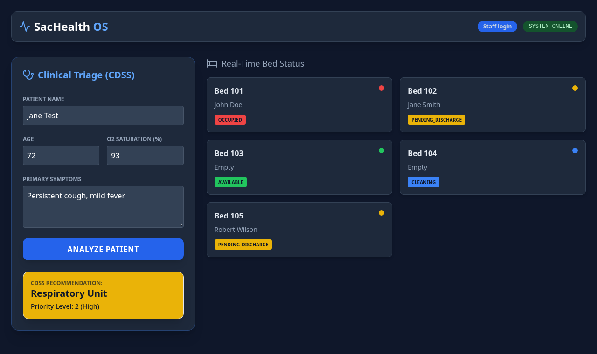

# 🏥 SacHealth OS — Clinical Triage & Bed Management System

> A HealthTech prototype that streamlines critical-patient flow and reduces hospital bottlenecks, inspired by the saturation challenges faced by hospitals in Sacramento, CA.



*Runs locally as a full-stack app (FastAPI backend + HTML/JS frontend). See [Running Locally](#️-running-locally).*

---

## 🚀 Overview

SacHealth OS helps emergency departments prioritize high-risk patients and see bed availability at a glance. It combines a **rule-based Clinical Decision Support System (CDSS)** for triage with a **bed-management dashboard** backed by a FastAPI REST API and a SQLite database.

The frontend handles failures gracefully: if the API is unreachable, it shows a clear **BACKEND OFFLINE** status and error messages instead of breaking.

---

## 🌟 Key Features

- **Clinical Decision Support System (CDSS):** A rule-based triage engine that assigns patient priority levels using established clinical thresholds (e.g. oxygen saturation, chest-pain indicators) to recommend the appropriate care level — from ICU to standard observation.
- **Bed Management Dashboard:** Bed cards loaded from the API, color-coded by status (Available, Occupied, Pending Discharge, Cleaning) with the assigned patient.
- **REST API + Database:** FastAPI endpoints (`GET /beds`, `POST /triage/analyze`) with Pydantic request validation and SQLModel/SQLite persistence; the database is created and seeded with sample beds on first run.
- **Connection Status & Error Handling:** A live SYSTEM ONLINE / BACKEND OFFLINE badge and friendly messages when the API is down.
- **Dark-Mode Clinical UI:** A focused, low-glare interface (Tailwind CSS + Lucide icons) suited to high-stress hospital environments.

---

## 🛠️ Tech Stack

| Layer | Technologies |
|-------|--------------|
| **Frontend** | HTML5, Tailwind CSS (CDN), Lucide icons, JavaScript (ES6+, Fetch API) |
| **Backend** | Python, FastAPI, Pydantic, Uvicorn |
| **Database** | SQLite via SQLModel (SQLAlchemy) |
| **Architecture** | REST API consumed by a static frontend |

---

## 🧠 How the Triage Engine Works

The CDSS (`POST /triage/analyze`) evaluates the patient's age, O₂ saturation, and symptoms against these rules, in order:

| Condition | Priority | Recommendation |
|-----------|----------|----------------|
| O₂ saturation < 90% or "chest pain" | **1 — Critical** | ICU (Immediate) |
| Age > 70 with "cough" | **2 — High** | Respiratory Unit |
| "fever" or "headache" | **3 — Moderate** | Urgent Care / Clinic |
| None of the above | **4 — Low** | Outpatient Clinic |

> This is a **rule-based** system grounded in clinical logic — a recognized and widely used category of decision support in real healthcare settings. It does not use machine learning; priorities are deterministic and fully auditable, which is often *preferred* in clinical contexts for transparency and safety.

---

## ⚙️ Running Locally

### 1. Backend (FastAPI)

```bash
git clone https://github.com/coderblockch/sachealth-os.git
cd sachealth-os/backend
python3 -m venv venv
source venv/bin/activate      # On Windows: venv\Scripts\activate
pip install fastapi uvicorn sqlmodel
uvicorn main:app --reload
# API available at http://127.0.0.1:8000 (interactive docs at /docs)
```

On first start it creates `sachealth.db` and seeds five sample beds.

### 2. Frontend

In a second terminal, from the project root, serve the page on a different port (the frontend calls the API at `http://127.0.0.1:8000`):

```bash
python3 -m http.server 5500
# Visit http://localhost:5500
```

---

## 🧪 Running Tests

The backend has **27 pytest tests** covering the triage rules, the API endpoints (including validation, CORS, and database errors), the models, and the database seeding. Each test runs against an isolated in-memory SQLite database.

```bash
cd backend
pip install -r requirements-dev.txt
pytest
```

---

## 📁 Project Structure

```
sachealth-os/
├── index.html          # Frontend dashboard (triage + bed management)
├── backend/
│   ├── main.py         # FastAPI app: /beds, /triage/analyze, startup seeding
│   ├── models.py       # SQLModel Bed table
│   └── database.py     # SQLite engine and table creation
├── docs/
│   └── screenshot.png
├── .gitignore
├── LICENSE
└── README.md
```

---

## 🗺️ Roadmap

- [x] Connect the frontend to the FastAPI backend.
- [x] Persist bed data in a database (SQLite via SQLModel).
- [ ] Save triaged patients and assign them to beds.
- [ ] Move to PostgreSQL for production.
- [ ] Add authentication for clinical staff roles.
- [ ] Deploy the full stack (frontend + API) to a cloud host.

---

## 👤 Author

**David Jimenez** — Full Stack Developer in training · Sacramento, CA

- GitHub: [@coderblockch](https://github.com/coderblockch)

---

## 📄 License

Distributed under the MIT License. See [`LICENSE`](LICENSE) for details.

---

> ⚠️ **Disclaimer:** SacHealth OS is an educational prototype and is **not** intended for real clinical use or actual patient care decisions.
