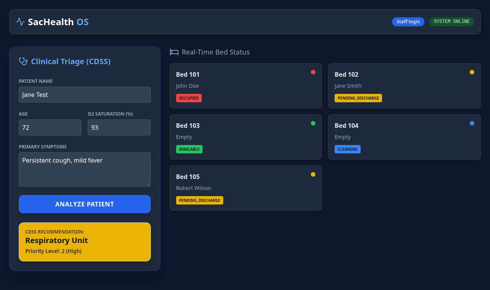
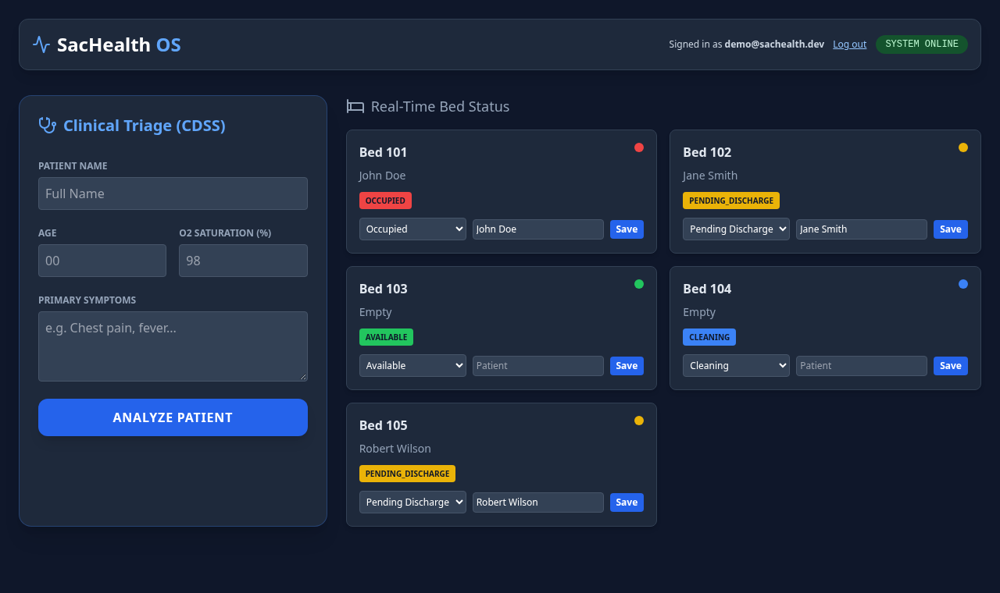
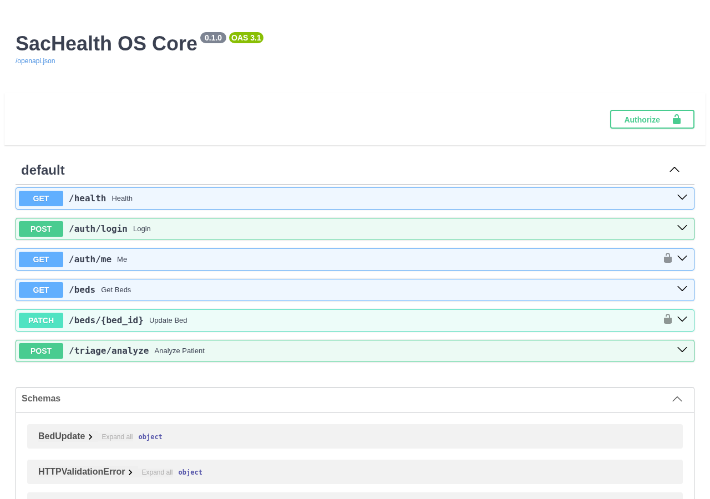

# 🏥 SacHealth OS — Clinical Triage & Bed Management

[](https://github.com/coderblockch/sachealth-os/actions/workflows/ci.yml)
[](https://github.com/coderblockch/sachealth-os/actions/workflows/codeql.yml)


[](LICENSE)

**The problem:** crowded emergency departments lose time deciding which patient is most critical and which bed is actually free.
**The solution:** one dashboard that triages patients with transparent, rule-based logic and shows live bed status from a REST API backed by a SQL database.

🔗 **Live demo:** [sachealth-os.onrender.com](https://sachealth-os.onrender.com) · **API docs:** [/docs](https://sachealth-os.onrender.com/docs)
**Demo login** (public demo account, fake data only): `demo@sachealth.dev` / `sachealth-demo`

> Free Render tier: the first request after ~15 min idle can take up to a minute. Demo data lives in SQLite and is re-seeded on every restart.

---

## 📸 Screenshots

| Dashboard: triage + bed status | Signed in as staff: beds can be updated |
|---|---|
|  |  |

| Auto-generated API docs (FastAPI / OpenAPI) |
|---|
|  |

🎬 **Demo video:** _coming soon (2-minute walkthrough)._ <!-- TODO(David): record a 2-min demo (triage → login → update a bed) and link it here -->

---

## 🌟 Features

- **Clinical Decision Support (CDSS):** rule-based triage that assigns a priority (1 Critical → 4 Low) from age, O₂ saturation and symptoms. Deterministic and auditable.
- **Bed management dashboard:** color-coded bed cards (Available, Occupied, Pending Discharge, Cleaning) loaded from the API.
- **Staff authentication:** bcrypt-hashed passwords and short-lived JWT bearer tokens; write endpoints require a token.
- **REST API + SQL database:** FastAPI with Pydantic validation and SQLModel (SQLAlchemy) persistence. SQLite by default, PostgreSQL via `DATABASE_URL`.
- **Resilient UI:** live SYSTEM ONLINE / BACKEND OFFLINE badge and friendly error messages when the API is down.
- **Tested and automated:** 43 pytest tests, GitHub Actions CI and CodeQL on every push and pull request.

## 🛠️ Tech Stack

| Layer | Technologies |
|-------|--------------|
| Frontend | HTML5, Tailwind CSS, Lucide icons, vanilla JavaScript (Fetch API) |
| Backend | Python, FastAPI, Pydantic, Uvicorn, PyJWT, bcrypt |
| Database | SQLModel / SQLAlchemy ORM · SQLite (default) · PostgreSQL (`psycopg`) |
| Testing & CI | pytest, FastAPI TestClient, GitHub Actions, CodeQL |
| Hosting | Render (`render.yaml` Blueprint) |

---

## 🏗️ Architecture

```
Browser ──► FastAPI (Uvicorn) ──► SQLModel / SQLAlchemy ──► SQLite (default) | PostgreSQL
              ├── GET   /                → dashboard (index.html)
              ├── GET   /health          → liveness probe
              ├── POST  /auth/login      → verify bcrypt hash, return JWT
              ├── GET   /auth/me         → current user           (Bearer)
              ├── GET   /beds            → list beds
              ├── PATCH /beds/{id}       → update status/patient  (Bearer)
              └── POST  /triage/analyze  → rule-based CDSS priority
```

One web service serves both the UI and the API (same origin, no CORS needed in production).

### 🗄️ Data model

```
┌──────────────────────────────┐      ┌──────────────────────────────────┐
│ bed                          │      │ user                             │
├──────────────────────────────┤      ├──────────────────────────────────┤
│ id       INTEGER  PK         │      │ id               INTEGER  PK     │
│ num      VARCHAR  (e.g. 101) │      │ email            VARCHAR  UNIQUE │
│ status   VARCHAR             │      │                           INDEX  │
│ patient  VARCHAR  NULL       │      │ full_name        VARCHAR         │
└──────────────────────────────┘      │ hashed_password  VARCHAR (bcrypt)│
                                      └──────────────────────────────────┘
```

- Tables are created from the SQLModel classes on startup (`SQLModel.metadata.create_all`) and seeded with five sample beds and the demo user.
- Each request gets its own `Session` via a FastAPI dependency; `pool_pre_ping` keeps PostgreSQL connections healthy.
- `postgres://` URLs (Render/Heroku style) are normalized to `postgresql+psycopg://` automatically.
- `bed.status` is validated by the API to one of `Available`, `Occupied`, `Pending_Discharge`, `Cleaning`.

### 🧠 Triage rules (`POST /triage/analyze`)

| Condition (evaluated in order) | Priority | Recommendation |
|-----------|----------|----------------|
| O₂ saturation < 90% or "chest pain" | **1 — Critical** | ICU (Immediate) |
| Age > 70 with "cough" | **2 — High** | Respiratory Unit |
| "fever" or "headache" | **3 — Moderate** | Urgent Care / Clinic |
| None of the above | **4 — Low** | Outpatient Clinic |

---

## ⚙️ Run Locally

```bash
git clone https://github.com/coderblockch/sachealth-os.git
cd sachealth-os/backend
python3 -m venv venv && source venv/bin/activate   # Windows: venv\Scripts\activate
pip install -r requirements.txt
uvicorn main:app --reload
# Dashboard: http://127.0.0.1:8000  ·  API docs: http://127.0.0.1:8000/docs
```

| Variable | Default | Purpose |
|----------|---------|---------|
| `DATABASE_URL` | `sqlite:///sachealth.db` | Any SQLAlchemy URL (PostgreSQL supported) |
| `JWT_SECRET` | random per process | Token signing secret (set in production) |
| `ACCESS_TOKEN_MINUTES` | `60` | Token lifetime |
| `DEMO_USER_EMAIL` / `DEMO_USER_PASSWORD` | demo account | Seeded staff account |
| `ALLOWED_ORIGINS` | local dev servers | CORS allow-list (comma-separated) |

## 🧪 Run Tests

```bash
cd backend
pip install -r requirements-dev.txt
pytest            # 43 tests: triage rules, auth, endpoints, models, database layer
```

Each test runs against an isolated in-memory SQLite database. The same suite runs in [GitHub Actions](https://github.com/coderblockch/sachealth-os/actions/workflows/ci.yml) on every push and pull request.

## ☁️ Deployment

[`render.yaml`](render.yaml) defines one free Render web service (installs `backend/requirements.txt`, starts Uvicorn, health check on `/health`). Pushes to `main` redeploy automatically.

---

## 🗺️ Roadmap

- [x] Frontend connected to the FastAPI backend
- [x] Bed data persisted in a SQL database (SQLModel)
- [x] JWT authentication for clinical staff
- [x] Full stack deployed to Render
- [ ] Save triaged patients and assign them to beds (new `patient` / `triage_record` tables with foreign keys)
- [ ] Role-based permissions (nurse vs. admin)
- [ ] Persistent PostgreSQL database with migrations (Alembic)

## 👤 Author

**David Jimenez** — Full-Stack Developer in training · Sacramento, CA
[GitHub @coderblockch](https://github.com/coderblockch) · [Portfolio](https://portfolio-bay-nine-59.vercel.app)

## 📄 License

MIT — see [`LICENSE`](LICENSE).

> ⚠️ Educational prototype. **Not** intended for real clinical use or patient care decisions.
